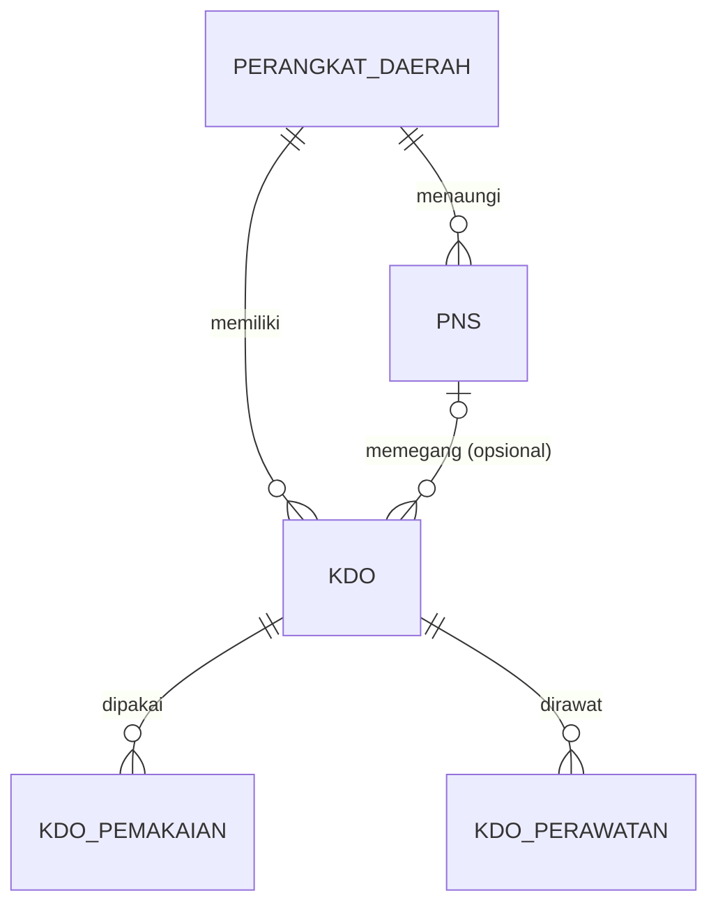

# SI-KDO: Sistem Informasi Kendaraan Dinas Operasional

Aplikasi web untuk mengelola Kendaraan Dinas Operasional (KDO) milik Perangkat Daerah sebagai bagian dari Barang Milik Daerah (BMD): pendataan kendaraan, kondisi, pegawai pemegang, riwayat perawatan, dan laporan siap cetak.

Demo: https://ivanrayhannn.github.io/Aplikasi-BMD-Jakarta-Test/ (data uji UAT Pemprov DKI Jakarta; perubahan tersimpan di browser Anda saja).

## Fitur

| Fase | Fitur | Isi |
|---|---|---|
| 0 | Data Master | CRUD perangkat daerah, PNS, dan kendaraan dengan cari, saring, paginasi, validasi field unik, aturan hapus berelasi |
| 1 | Dashboard | Total aset, kendaraan sedang dipakai, sebaran kondisi, aset terbaru, pengingat servis, STNK/pajak, dan pembaruan data |
| 2 | Pemakai Kendaraan | Tautkan pegawai ke kendaraan, tutup pemakaian, riwayat dari sisi kendaraan dan pegawai |
| 3 | Riwayat Perawatan | Catat servis dan biaya, kondisi setelah servis, jadwal servis berikutnya, rekap biaya |
| 3 | Laporan & Cetak | Laporan kendaraan, pemakaian, perawatan dengan kop instansi; cetak, unduh PDF dan Excel |
| 4 | Masuk & Hak Akses | Login email, peran Pengelola Aset (admin) dan Petugas Lapangan (lihat saja), kelola pengguna |
| 4 | Pengaturan | Nama, alamat, logo instansi untuk kop; hari pengingat; daftar pilihan terkendali |
| - | Rancangan Database | ERD, kamus data per tabel, relasi dan aturan hapus, unduh DDL MySQL |

Kebutuhan lengkap, aturan bisnis, status implementasi, dan keterlacakan ada di [docs/PRD.md](docs/PRD.md).

## Relasi entitas



- Hapus perangkat daerah yang masih punya PNS/KDO ditolak `409`.
- Hapus PNS diizinkan: pemegang kendaraan menjadi kosong, riwayat tetap tersimpan.
- Satu kendaraan hanya punya satu pemakaian aktif; pemegang wajib PNS aktif.

## Menjalankan

Butuh Node.js 22.5 atau lebih baru.

```bash
npm ci
```

```bash
npm start
```

Buka http://localhost:3000, masuk dengan `admin@kdo.test` / `admin12345`. Data awal: 36 SKPD DKI Jakarta, ditambah 20 pegawai dan 20 kendaraan uji dari [docs/data](docs/data/data_aset_kendaraan_dki.md). Untuk produksi tanpa data uji: `SEED_SAMPLE=0 npm start`. Langkah lengkap dan pemecahan masalah: [docs/SETUP.md](docs/SETUP.md).

## Endpoint

Base `/api/v1`, respons `{ data, meta }` atau `{ error: { code, message, details } }`.

| Sumber daya | Endpoint |
|---|---|
| Autentikasi | `POST /auth/login`, `POST /auth/logout`, `GET /auth/me`, `GET /referensi` |
| Perangkat daerah | `GET/POST /perangkat-daerah`, `GET/PUT/DELETE /perangkat-daerah/{id}` |
| PNS | `GET/POST /pns`, `GET/PUT/DELETE /pns/{id}` |
| Kendaraan | `GET/POST /kdo`, `GET/PUT/DELETE /kdo/{id}` |
| Pemakaian | `GET/POST /pemakaian`, `GET /pemakaian/{id}`, `POST /pemakaian/{id}/selesai` |
| Perawatan | `GET/POST /perawatan`, `GET /perawatan/jadwal`, `GET /perawatan/rekap`, `GET/PUT/DELETE /perawatan/{id}` |
| Dashboard & laporan | `GET /dashboard`, `GET /laporan/kendaraan`, `GET /laporan/pemakaian`, `GET /laporan/perawatan` |
| Administrasi | `GET/POST /pengguna`, `GET/PUT /pengguna/{id}`, `GET/PUT /pengaturan`, `GET /log-aktivitas` |

Parameter, kode error, dan contoh: [docs/API.md](docs/API.md). Koleksi Postman: [docs/postman/](docs/postman/).

## Teknologi

| Lapisan | Teknologi |
|---|---|
| Frontend | Vue 3 (ES module, tanpa build step), disajikan dari `node_modules` tanpa CDN |
| Backend | Node.js + Express 5, REST API `/api/v1` |
| Database | SQLite (`node:sqlite`); DDL setara MySQL 8.4 di `db/mysql/` |
| Laporan | jsPDF + jspdf-autotable (PDF), ExcelJS (Excel) |
| Demo statis | API yang sama dijalankan di browser dengan sql.js (WebAssembly) |

Alasan pemilihan dan perbedaannya dengan rekomendasi PRD: [docs/PRD.md bagian 11](docs/PRD.md#11-arsitektur-dan-keputusan-implementasi).

## Pengujian

| Lapisan | Perintah | Cakupan |
|---|---|---|
| Unit + API | `npm test` | 45 uji: validasi, aturan bisnis, hak akses, data awal, kesesuaian rancangan DB |
| Kontrak API | Newman (lihat `docs/API.md`) | 68 permintaan, 95 asersi |
| UI end-to-end | `npm run test:e2e` | 42 langkah click-through, mode server dan demo |

## Dokumentasi

| Berkas | Isi |
|---|---|
| [docs/PRD.md](docs/PRD.md) | PRD terdokumentasi: kebutuhan, kriteria penerimaan, aturan bisnis, keputusan, keterlacakan |
| [docs/prd/sumber/](docs/prd/sumber/) | PRD dan spesifikasi fitur asli dari pemilik produk (arsip) |
| [docs/API.md](docs/API.md) | Referensi REST API |
| [docs/SETUP.md](docs/SETUP.md) | Manual setup dan pemecahan masalah |
| [docs/screenshots/KDO-Screenshots.xlsx](docs/screenshots/) | Bukti UI: screenshot per alur |
| [db/mysql/kdo_master_tables.sql](db/mysql/kdo_master_tables.sql) | DDL MySQL 8.4 |
| [DESIGN.md](DESIGN.md) | Arah desain dan alasan keputusan visual |
| [AGENTS.md](AGENTS.md) | Konvensi kode dan aturan kerja |
