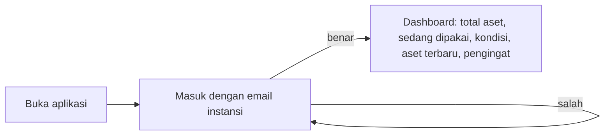
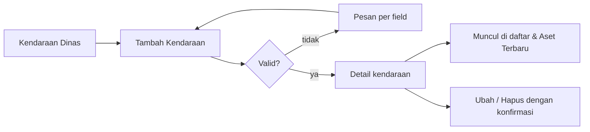
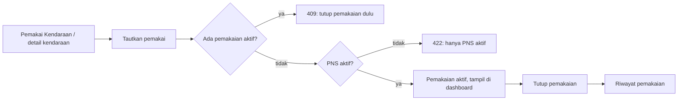
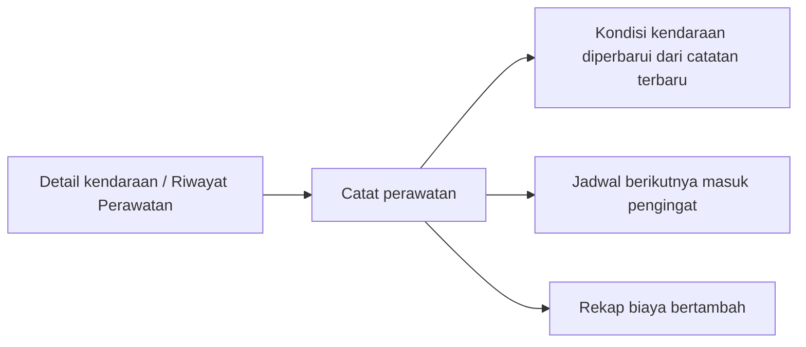
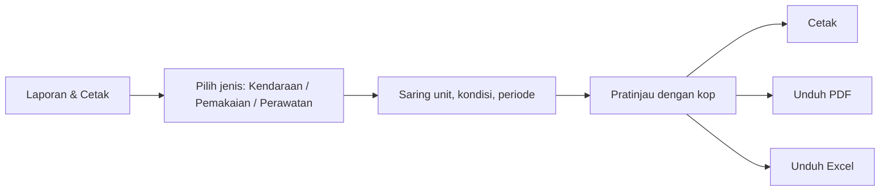
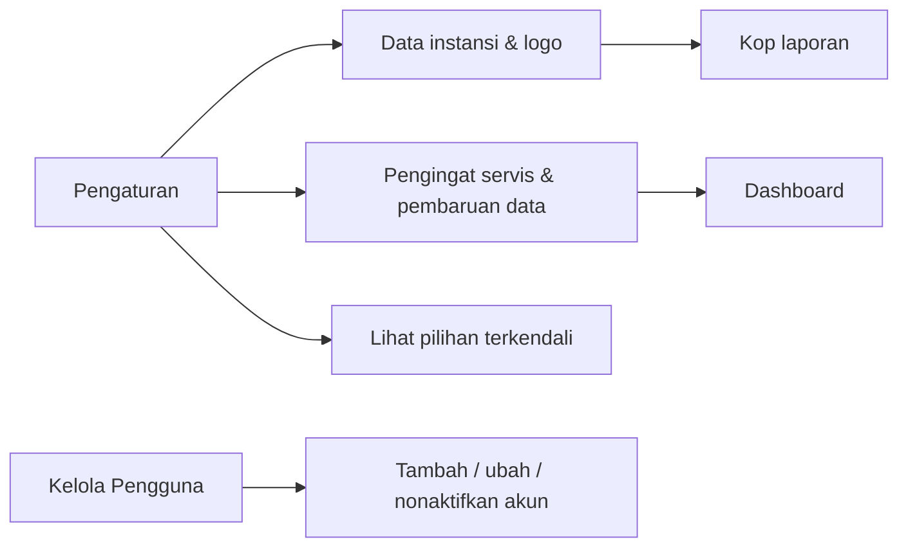
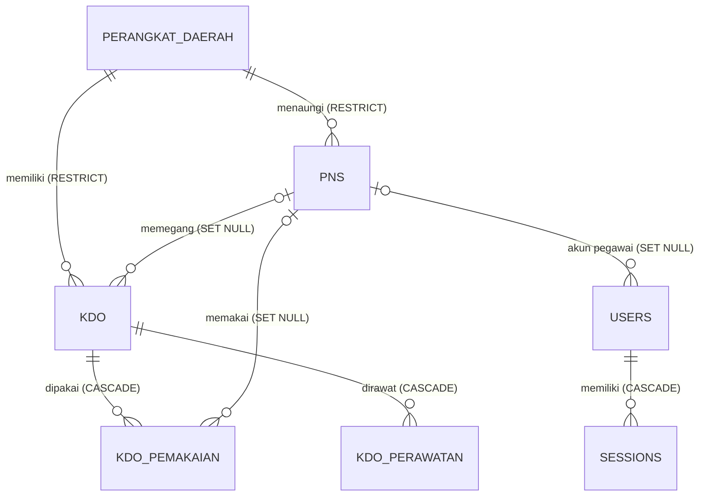
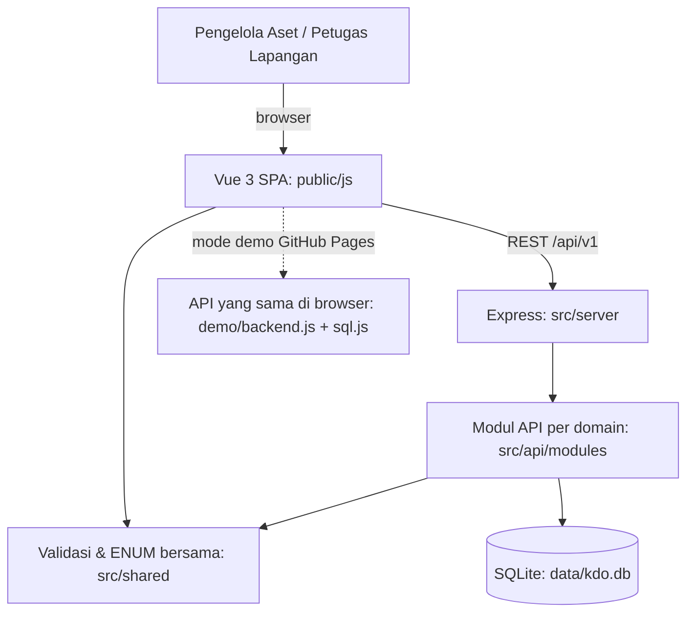

# PRD SI-KDO: Sistem Informasi Kendaraan Dinas Operasional

| Atribut | Isi |
|---|---|
| Dokumen | Product Requirements Document (versi terdokumentasi) |
| Versi | 1.1 |
| Status | Draf untuk review dan sign-off pengguna |
| Sumber | `docs/prd/sumber/PRD.md` dan `docs/prd/sumber/features/01` s.d. `08` (diarsipkan apa adanya) |
| Aplikasi | Branch `claude/dreamy-pascal-qxpvy1`, demo: https://ivanrayhannn.github.io/Aplikasi-BMD-Jakarta-Test/ |

Dokumen ini merapikan PRD sumber menjadi satu acuan: setiap kebutuhan diberi ID, kriteria penerimaan dikumpulkan per fitur, dan setiap butir dipetakan ke status implementasi, kode, dan pengujian. Isi kebutuhan tidak diubah. Bila implementasi menyimpang dari PRD sumber, penyimpangan dan alasannya dicatat di bagian 11.

Label status yang dipakai:

| Status | Arti |
|---|---|
| Selesai | Diimplementasikan dan diuji otomatis (uji API dan/atau click-through UI) |
| Selesai, beda pendekatan | Kebutuhan terpenuhi dengan cara berbeda dari rekomendasi PRD; lihat bagian 11 |
| Sebagian | Sebagian kriteria terpenuhi; sisanya disebut di kolom catatan |
| Belum | Belum dikerjakan |

## Daftar isi

1. [Latar belakang dan masalah](#1-latar-belakang-dan-masalah)
2. [Tujuan](#2-tujuan)
3. [Pengguna dan peran](#3-pengguna-dan-peran)
4. [Ruang lingkup](#4-ruang-lingkup)
5. [Kebutuhan fungsional](#5-kebutuhan-fungsional)
6. [Kebutuhan non-fungsional](#6-kebutuhan-non-fungsional)
7. [Spesifikasi fitur per fase](#7-spesifikasi-fitur-per-fase)
8. [Aturan bisnis](#8-aturan-bisnis)
9. [Alur pengguna](#9-alur-pengguna)
10. [Model data](#10-model-data)
11. [Arsitektur dan keputusan implementasi](#11-arsitektur-dan-keputusan-implementasi)
12. [Matriks keterlacakan dan pengujian](#12-matriks-keterlacakan-dan-pengujian)
13. [Pertanyaan terbuka](#13-pertanyaan-terbuka)
14. [Riwayat revisi](#14-riwayat-revisi)

## 1. Latar belakang dan masalah

Perangkat Daerah memiliki banyak Kendaraan Dinas Operasional (KDO) sebagai bagian dari Barang Milik Daerah (BMD). Pendataan kendaraan, kondisi, dan pemakainya masih manual atau tersebar di banyak berkas, sehingga:

| Kode | Masalah |
|---|---|
| M-1 | Jumlah dan kondisi kendaraan dinas sulit diketahui dengan cepat. |
| M-2 | Pegawai yang bertanggung jawab atas suatu kendaraan tidak jelas. |
| M-3 | Riwayat perawatan dan biaya servis tidak terdokumentasi rapi. |
| M-4 | Laporan rekapitulasi harus disusun ulang setiap kali dibutuhkan. |

## 2. Tujuan

Satu tempat untuk mengelola seluruh data KDO milik Instansi Aset Daerah Jakarta.

| Kode | Tujuan | Menjawab |
|---|---|---|
| T-1 | Total aset kendaraan dan kondisinya terlihat dalam satu layar (dashboard). | M-1 |
| T-2 | Pegawai penanggung jawab setiap kendaraan tercatat beserta riwayat pemakaiannya. | M-2 |
| T-3 | Riwayat perawatan, biaya servis, dan jadwal servis berikutnya terdokumentasi. | M-3 |
| T-4 | Laporan siap pakai dapat dicetak atau diunduh (PDF/Excel) tanpa menyusun ulang data. | M-4 |
| T-5 | Akses data dibatasi lewat akun dan peran pengguna. | Keamanan data aset |
| T-6 | Pekerjaan diserahkan bersama bukti dokumentasi dan pengujian: screenshot UI dalam workbook Excel, koleksi Postman, README, `AGENTS.md`, dan manual setup. | Serah terima |

**First win:** saat pertama membuka aplikasi, petugas langsung melihat total aset, kendaraan yang sedang dipakai, kondisi, dan aset terbaru.

## 3. Pengguna dan peran

| Peran | Nilai di sistem | Hak akses |
|---|---|---|
| Pengelola Aset | `admin` | Melihat dan mengubah seluruh data: data master, pemakaian, perawatan, pengguna, pengaturan, log aktivitas. |
| Petugas Lapangan | `petugas` | Hanya melihat data (dashboard, daftar, detail, laporan). Tombol tambah/ubah/hapus tidak tampil; API menolak dengan `403`. |

Aplikasi dipakai internal oleh instansi, bukan publik. Pengguna utama adalah staf non-teknis.

## 4. Ruang lingkup

**Termasuk:** CRUD tiga entitas master (`perangkat_daerah`, `pns`, `kdo`), dashboard, pemakaian kendaraan, riwayat perawatan, laporan dan cetak, masuk dan hak akses, pengaturan aplikasi, serta dokumentasi dan bukti uji.

**Di luar cakupan (PRD sumber):** pelacakan GPS real-time, aplikasi mobile native, dan integrasi langsung dengan sistem akuntansi daerah.

**Batasan dan asumsi:** skala ratusan sampai beberapa ribu kendaraan; data awal dimasukkan manual atau lewat impor bertahap (impor belum dibuat, lihat bagian 13).

## 5. Kebutuhan fungsional

| ID | Kebutuhan | Keterangan PRD | Status | Catatan |
|---|---|---|---|---|
| F1 | Dashboard ringkasan kendaraan | Total aset, sedang dipakai, status kondisi, aset terbaru | Selesai | Ditambah panel pengingat (fitur 07). |
| F2 | Tambah, lihat, ubah, hapus kendaraan dinas | Termasuk cari dan saring | Selesai | |
| F3 | Catat pegawai dan tautkan ke kendaraan | Beserta riwayat pemakaian | Selesai | |
| F4 | Riwayat perawatan | Tanggal, biaya, kondisi setelah servis, jadwal berikutnya | Selesai | |
| F5 | Buat, cetak, unduh laporan | PDF dan Excel | Selesai, beda pendekatan | Berkas dibuat di browser dari data API yang sama (bagian 11, K-5). |
| F6 | Masuk dengan akun, peran berbeda | Pengelola aset vs petugas lapangan | Selesai, beda pendekatan | Autentikasi buatan sendiri, bukan Better Auth (K-3). |
| F7 | Atur data instansi dan pengingat | Nama dan logo untuk kop laporan | Selesai | |
| F8 | CRUD penuh tiga entitas master | Cari, saring, validasi field unik | Selesai | |
| F9 | Screenshot setiap halaman, form, dialog dalam workbook Excel | Gaya Crossdock | Selesai | `docs/screenshots/KDO-Screenshots.xlsx` |
| F10 | REST API terdokumentasi, dapat diuji Postman | Koleksi Postman berurutan | Selesai | `docs/postman/`, dijalankan dengan Newman (bagian 12). |
| F11 | README, `AGENTS.md`, manual setup | Relasi entitas, cara menjalankan, endpoint | Selesai, beda pendekatan | Setup memakai Node.js + SQLite; jalur MySQL/Laragon tersedia sebagai DDL (K-1). |

## 6. Kebutuhan non-fungsional

| ID | Kebutuhan | Cara dipenuhi | Status |
|---|---|---|---|
| NF-1 | Mudah dipakai staf non-teknis | Bahasa Indonesia sederhana, label terlihat di setiap field dan filter, pesan error menyebut field dan langkah perbaikan, state kosong memberi arahan. | Selesai |
| NF-2 | Cepat: cari dan saring dalam hitungan detik | Query SQL berindeks, paginasi server (20 baris, maks 1000), pencarian dengan jeda 250 ms. Belum ada uji beban; waktu respons belum diukur. | Sebagian |
| NF-3 | Aman: data hanya setelah login, hak ubah sesuai peran | Token sesi 8 jam, sandi di-hash scrypt, semua `/api/v1` wajib sesi, tulis hanya admin, akun nonaktif tidak bisa masuk dan sesinya dicabut. | Selesai |
| NF-4 | Konsisten: data saling terhubung, tanpa input ganda | Pemegang kendaraan hanya diubah lewat pemakaian; kondisi diperbarui otomatis dari perawatan terbaru; laporan memakai filter dan query yang sama dengan daftar. | Selesai |
| NF-5 | Dapat dicetak: kop instansi, siap ditandatangani | Gaya cetak tanpa navigasi, kop (nama, alamat, logo), tanggal cetak, kolom tanda tangan. | Selesai |
| NF-6 | Ringan: server instansi atau cloud kecil | Satu proses Node.js, SQLite satu berkas, tanpa layanan eksternal; demo statis di GitHub Pages. | Selesai |
| NF-7 | Kualitas kode tinggi | Struktur per domain, validasi di satu tempat, format error seragam, tanpa duplikasi logika antara server dan demo; konvensi di `AGENTS.md`. | Selesai |
| NF-8 | Integritas relasi `perangkat_daerah → pns → kdo` | FK di database + validasi API (409/422). | Selesai |
| NF-9 | Dokumentasi diperbarui bersama kode | README, `AGENTS.md`, `docs/API.md`, Postman, workbook screenshot ikut di repo. | Selesai |
| NF-10 | Aksesibilitas (tambahan, belum tertulis di PRD sumber) | Kontras WCAG AA diverifikasi, navigasi keyboard dan fokus terlihat, target sentuh 44 px di ponsel, tabel menjadi kartu di layar kecil. | Selesai |

## 7. Spesifikasi fitur per fase

Setiap fitur merangkum "Tujuan" dan "Selesai bila" dari berkas fitur sumber. Kriteria penerimaan diberi ID agar dapat dirujuk di UAT.

### Fase 0: Data Master (fitur 08, prioritas tinggi, fitur utama)

**Tujuan:** satu tempat mengelola `perangkat_daerah`, `pns`, dan `kdo` sebagai fondasi; fitur lain hanya membaca data ini.

| ID | Kriteria penerimaan | Status |
|---|---|---|
| DM-1 | Ketiga entitas dapat ditambah, dilihat, diubah, dihapus dari UI maupun API dengan respons `{ data, meta }` / `{ error: { code, message } }`. | Selesai |
| DM-2 | Setiap daftar punya pencarian dan saringan. | Selesai |
| DM-3 | Data ganda atau format salah ditolak dengan kode status dan pesan yang menyebut field. | Selesai |
| DM-4 | Relasi antar entitas terlihat di layar; penghapusan berelasi ditolak atau ditangani sesuai aturan. | Selesai |
| DM-5 | Koleksi Postman berjalan berurutan; setiap layar data master punya screenshot di workbook. | Selesai |
| DM-6 | README, `AGENTS.md`, `docs/SETUP.md` memuat relasi entitas, endpoint, dan langkah setup dari nol. | Selesai |

**Perangkat Daerah**

| ID | Kriteria penerimaan | Status |
|---|---|---|
| PD-1 | Form memuat kode, nama dinas, singkatan, alamat, telepon, email, status aktif; validasi email/telepon di satu tempat. | Selesai |
| PD-2 | Cari berdasarkan kode/nama, saring status aktif; data nonaktif punya penanda visual. | Selesai |
| PD-3 | `kode` atau `nama_dinas` yang sudah dipakai ditolak `422` dengan nama field. | Selesai |
| PD-4 | `DELETE` saat masih punya PNS/KDO ditolak `409` beserta jumlah penghalang. | Selesai |
| PD-5 | Detail menampilkan PNS dan kendaraan milik unit. | Selesai |

**PNS**

| ID | Kriteria penerimaan | Status |
|---|---|---|
| PNS-1 | Dropdown golongan, jenis kelamin, status kepegawaian, dan perangkat daerah, tanpa input bebas. | Selesai |
| PNS-2 | Cari nama/NIP, saring status kepegawaian dan unit kerja. | Selesai |
| PNS-3 | NIP bukan 18 digit atau sudah terdaftar ditolak `422` per field. | Selesai |
| PNS-4 | `DELETE` PNS yang memegang kendaraan berhasil; `kdo.pemegang_pns_id` menjadi `NULL` dan terlihat di layar kendaraan. | Selesai |
| PNS-5 | Detail menampilkan kendaraan yang dipegang dan riwayat pemakaian. | Selesai |

**Kendaraan Dinas (KDO)**

| ID | Kriteria penerimaan | Status |
|---|---|---|
| KDO-1 | Form dikelompokkan: identitas, legalitas, nilai dan aset, penempatan; ENUM sebagai dropdown, tanggal dengan date picker. | Selesai |
| KDO-2 | Dropdown pemegang hanya berisi PNS aktif dan dapat dikosongkan. | Selesai |
| KDO-3 | Nomor polisi/rangka/mesin ganda, tahun di luar 1980 s.d. 2100, atau PNS nonaktif sebagai pemegang ditolak `422`. | Selesai |
| KDO-4 | Cari nomor polisi/merek/tipe; saring kondisi, jenis, unit, status aktif, dan "belum ada pemegang". | Selesai |
| KDO-5 | Detail menampilkan seluruh atribut, status jatuh tempo STNK/pajak, tautan ke unit dan pemegang. | Selesai |

### Fase 1: Dashboard Kendaraan (fitur 01, prioritas tinggi)

| ID | Kriteria penerimaan | Status |
|---|---|---|
| DB-1 | Empat bagian tampil sekaligus: total aset, sedang dipakai, status kondisi, aset terbaru. | Selesai |
| DB-2 | Angka berasal dari data yang sama dengan daftar kendaraan (tanpa selisih). | Selesai |
| DB-3 | Setiap bagian punya keadaan kosong yang jelas. | Selesai |
| DB-4 | Hanya setelah login; rapi di laptop dan desktop lebar (juga ponsel). | Selesai |
| DB-5 | Total tampil menonjol dengan format ribuan dan label "Total Kendaraan Dinas". | Selesai |
| DB-6 | Daftar sedang dipakai: nomor polisi, merek/tipe, nama pemakai; hanya pemakaian aktif. | Selesai |
| DB-7 | Tiga ringkasan kondisi berwarna konsisten; jumlahnya sama dengan total aset. | Selesai |
| DB-8 | Aset terbaru: 5 teratas, urut terbaru, dengan tanggal penambahan. | Selesai |

### Fase 2: Daftar Kendaraan Dinas (fitur 02, prioritas tinggi)

| ID | Kriteria penerimaan | Status |
|---|---|---|
| DK-1 | Kolom utama: nomor polisi, merek/tipe, jenis, kondisi, pemegang. | Selesai |
| DK-2 | Cari nomor polisi; saring jenis dan kondisi, dapat dikosongkan kembali. | Selesai |
| DK-3 | Setiap baris membuka detail; tersedia tambah, ubah, hapus. | Selesai |
| DK-4 | Daftar menampilkan data terbaru setelah perubahan; pesan jelas bila kosong. | Selesai |
| DK-5 | Konfirmasi hapus menyebut nomor polisi. | Selesai |

### Fase 2: Pemakai Kendaraan (fitur 03, prioritas sedang)

| ID | Kriteria penerimaan | Status |
|---|---|---|
| PK-1 | CRUD pegawai dengan field wajib (NIP 18 digit, nama, jabatan, unit kerja), cari dan saring. | Selesai |
| PK-2 | Tautkan satu kendaraan ke satu pegawai; tanggal mulai terisi, status aktif; langsung tampil di dashboard. | Selesai |
| PK-3 | Kendaraan dengan pemakaian aktif tidak dapat ditautkan lagi; pesan meminta menutup pemakaian dulu. | Selesai |
| PK-4 | Tutup pemakaian dengan tanggal selesai; status menjadi selesai. | Selesai |
| PK-5 | Riwayat dapat dilihat dari halaman kendaraan dan halaman pegawai. | Selesai |
| PK-6 | Pegawai yang masih memegang kendaraan tidak dihapus tanpa penjelasan ke petugas. | Selesai (dialog hapus menyebut kendaraan yang akan dilepas) |

### Fase 3: Riwayat Perawatan (fitur 04, prioritas tinggi)

| ID | Kriteria penerimaan | Status |
|---|---|---|
| RP-1 | Daftar servis per kendaraan (tanggal, jenis, bengkel, biaya, kondisi setelah), terbaru di atas. | Selesai |
| RP-2 | Tambah, ubah, hapus catatan dengan konfirmasi sebelum hapus. | Selesai |
| RP-3 | Biaya format Rupiah (Rp1.250.000), tanggal mudah dibaca (12 Feb 2025). | Selesai |
| RP-4 | Total biaya dan jadwal servis berikutnya terlihat di riwayat kendaraan. | Selesai |
| RP-5 | Kondisi kendaraan diperbarui sesuai kondisi setelah servis. | Selesai (dari catatan terbaru, lihat BR-14) |
| RP-6 | Jadwal dekat atau terlewat ditandai "Segera servis" / "Terlambat"; daftar kendaraan perlu servis urut jadwal terdekat. | Selesai |
| RP-7 | Rekap semua kendaraan: jumlah servis dan total biaya, urut biaya terbesar; angka sama dengan riwayat. | Selesai |

### Fase 3: Laporan & Cetak (fitur 05, prioritas tinggi)

| ID | Kriteria penerimaan | Status |
|---|---|---|
| LP-1 | Tiga jenis laporan: Daftar Kendaraan, Pemakaian, Perawatan. | Selesai |
| LP-2 | Pratinjau dengan kop instansi (nama dan logo), judul, tanggal cetak. | Selesai |
| LP-3 | Cetak dan unduh PDF/Excel dengan isi dan angka sama dengan pratinjau. | Selesai |
| LP-4 | Saringan langsung mengubah pratinjau tanpa memuat ulang halaman. | Selesai |
| LP-5 | Data kosong: pesan jelas, tombol cetak/unduh tidak menghasilkan berkas kosong. | Selesai (tombol dinonaktifkan) |
| LP-6 | Laporan kendaraan: ringkasan per kondisi dan total. | Selesai |
| LP-7 | Laporan pemakaian: rentang tanggal, "Masih berjalan" untuk pemakaian aktif. | Selesai |
| LP-8 | Laporan perawatan: total per kendaraan dan total keseluruhan, saring kendaraan dan rentang tanggal. | Selesai |
| LP-9 | Cetak tanpa navigasi aplikasi; nama berkas menyebut jenis laporan dan tanggal. | Selesai |

### Fase 4: Masuk & Hak Akses (fitur 06, prioritas sedang)

| ID | Kriteria penerimaan | Status |
|---|---|---|
| HA-1 | Belum masuk tidak dapat membuka data; diarahkan ke halaman masuk. | Selesai |
| HA-2 | Masuk dengan email dan kata sandi; salah mendapat pesan jelas. | Selesai |
| HA-3 | Nama dan peran tampil; tombol keluar mengakhiri sesi. | Selesai |
| HA-4 | Tombol ubah/hapus hanya untuk peran berhak; yang lain hanya melihat. | Selesai |
| HA-5 | Membuka alamat terlarang menampilkan pesan penolakan, bukan data. | Selesai |
| HA-6 | Admin mengelola pengguna: tambah, ubah, nonaktifkan; email unik; nonaktif tidak bisa masuk. | Selesai |

### Fase 4: Pengaturan Aplikasi (fitur 07, prioritas rendah)

| ID | Kriteria penerimaan | Status |
|---|---|---|
| PA-1 | Tiga bagian: Data Instansi, Pilihan Terkendali, Pengingat. | Selesai |
| PA-2 | Perubahan langsung tercermin pada kop laporan. | Selesai |
| PA-3 | Hanya admin yang dapat mengubah; pesan berhasil/gagal jelas. | Selesai |
| PA-4 | Unggah/ganti logo; bila tidak ada logo, kop tetap menampilkan nama instansi. | Selesai |
| PA-5 | Pilihan terkendali untuk jenis kendaraan, kondisi, golongan, bahan bakar, status kepegawaian; nilai di luar daftar ditolak. | Selesai |
| PA-6 | Atur hari pengingat servis dan pengingat pembaruan data; tampil di dashboard dan tersimpan. | Selesai |

## 8. Aturan bisnis

| ID | Aturan | Sumber | Ditegakkan di |
|---|---|---|---|
| BR-01 | `kode` dan `nama_dinas` perangkat daerah unik. | PRD 6.1, fitur 08 | DB UNIQUE + API 422 |
| BR-02 | NIP 18 digit angka dan unik. | PRD 6.2 | DB + API 422 |
| BR-03 | Nomor polisi, rangka unik; nomor mesin unik bila diisi; nomor polisi berformat `B 1234 ABC` dan disimpan huruf kapital. | PRD 6.3 | DB + API 422 |
| BR-04 | Tahun produksi 1980 s.d. 2100. | PRD 6.3 | DB CHECK + API 422 |
| BR-05 | Hapus perangkat daerah yang masih punya PNS/KDO ditolak `409` dengan jumlah penghalang. | PRD 6 | API + FK RESTRICT |
| BR-06 | Hapus PNS diizinkan; `kdo.pemegang_pns_id` menjadi `NULL`. | PRD 6 (keputusan final) | FK SET NULL |
| BR-07 | Pemegang/pemakai wajib PNS berstatus `aktif` (`422`). | PRD 6 | API |
| BR-08 | Satu kendaraan hanya punya satu pemakaian aktif (`409`). | PRD 6, fitur 03 | Unique index parsial + API |
| BR-09 | Riwayat pemakaian dan perawatan ikut terhapus saat kendaraan dihapus. | PRD 6 | FK CASCADE |
| BR-10 | Petugas lapangan hanya dapat melihat; semua aksi tulis `403`. | Fitur 06 | Middleware API + UI |
| BR-11 | Akun nonaktif tidak dapat masuk; sesinya dicabut saat dinonaktifkan. | Fitur 06 | API |
| BR-12 | Email pengguna unik. | Fitur 06 | DB + API 422 |
| BR-13 | Nilai ENUM di luar daftar ditolak. | Fitur 07 | DB CHECK + API 422 |
| BR-14 | Kondisi kendaraan mengikuti `kondisi_setelah` dari catatan perawatan **terbaru**. Catatan susulan bertanggal lebih lama tidak menimpa kondisi terkini. | Fitur 04 (diperjelas) | API |
| BR-15 | Pemegang kendaraan hanya berubah lewat tautkan/tutup pemakaian, agar riwayat selalu terbentuk. Menambah kendaraan dengan pemegang otomatis membuka pemakaian mulai hari ini. | Turunan PRD "tanpa input ganda" | API + UI |
| BR-16 | Saat PNS dihapus, pemakaian aktifnya ditutup hari ini; nama dan NIP tersimpan di riwayat. | Tambahan, menjaga riwayat | API |
| BR-17 | Status PNS tidak dapat diubah dari `aktif` selama masih memegang kendaraan (`409`). | Tambahan, perlu konfirmasi (Q-3) | API |
| BR-18 | Kendaraan yang masih dipakai tidak dapat dinonaktifkan (`409`). | Tambahan | API |
| BR-19 | Tanggal servis, tanggal mulai, dan tanggal selesai pemakaian tidak boleh di masa depan; jadwal servis berikutnya harus setelah tanggal servis; biaya tidak negatif. | Fitur 04 "tanggal tidak wajar" | API + DB CHECK |
| BR-20 | Harus selalu ada minimal satu admin aktif; admin tidak dapat menonaktifkan atau menurunkan perannya sendiri. | Tambahan, mencegah terkunci | API |

## 9. Alur pengguna

### A. Pertama kali (first win)

### B. Pendataan kendaraan

### C. Penautan pemakai

### D. Perawatan

### E. Laporan

### F. Pengaturan (admin)

## 10. Model data

Rancangan lengkap (kolom, tipe, constraint) ada di `db/mysql/kdo_master_tables.sql` (MySQL 8.4) dan `src/api/schema.js` (SQLite yang dipakai aplikasi).

| Tabel | Fungsi | Kunci dan constraint utama |
|---|---|---|
| `perangkat_daerah` | Master unit pemilik aset | `kode` unik, `nama_dinas` unik |
| `pns` | Master pegawai | `nip` unik 18 digit, FK `perangkat_daerah_id` |
| `kdo` | Master kendaraan | `nomor_polisi`, `nomor_rangka`, `nomor_mesin` unik; tahun 1980 s.d. 2100; FK unit (wajib) dan pemegang (opsional) |
| `kdo_pemakaian` | Riwayat pemakaian | Satu baris `aktif` per kendaraan; potret `pns_nama`, `pns_nip` |
| `kdo_perawatan` | Riwayat servis | Biaya ≥ 0; jadwal berikutnya setelah tanggal servis |
| `users` | Akun aplikasi | `email` unik; `role` admin/petugas |
| `sessions` | Sesi login | Kedaluwarsa 8 jam |
| `settings` | Kop instansi dan pengingat | Satu baris (`id = 1`) |
| `log_aktivitas` | Jejak audit | Setiap tambah/ubah/hapus, login, tautkan pemakaian |

Data awal diambil dari berkas pemilik produk `docs/data/data_aset_kendaraan_dki.md` (dibangkitkan ke `src/api/seed-data.js` oleh `scripts/generate-seed-data.mjs`), menggantikan contoh PD-001 s.d. PD-003 di PRD sumber:

- **Data wajib** (selalu dibuat): 36 SKPD Pemprov DKI Jakarta (`SKPD-01` s.d. `SKPD-36`), satu akun admin, dan pengaturan instansi. Nomenklatur SKPD perlu dicek ulang sebelum produksi.
- **Data uji UAT** (dilewati bila `SEED_SAMPLE=0`): 20 pegawai, 20 kendaraan (nilai perolehan Rp11.215.600.000; Baik 15, Rusak Ringan 3, Rusak Berat 2), pemakaian aktif sesuai pemegang, dan akun petugas. Aplikasi menandainya "Lingkungan uji (UAT)".

Penyesuaian data sumber ke skema:

| Data sumber | Di sistem |
|---|---|
| Jenis gabungan, mis. "Roda 4 – Operasional", "Ambulans", "Truk Sampah" | Jenis ke ENUM (`roda_4`, `roda_2`, `truk`, `lainnya`); peruntukan atau jenis khusus disimpan di `keterangan` (lihat Q-8) |
| "Merk / Tipe" satu kolom | Kata pertama menjadi `merek`, sisanya `tipe` |
| Kode aset (KND-...) | `kode_barang_aset` |
| Pemegang (NIP) | Pemakaian aktif, tanggal mulai = tanggal data dimuat (sumber tidak memuat tanggal penugasan) |
| Nomor mesin, STNK, pajak, tanggal perolehan, riwayat servis | Tidak ada di sumber, dibiarkan kosong. `nomor_mesin` dibuat boleh kosong dan tetap unik bila diisi (K-9) |

## 11. Arsitektur dan keputusan implementasi

Arahan pemilik produk adalah merapikan aplikasi yang sudah ada, bukan menggantinya. Karena itu beberapa rekomendasi teknologi di PRD sumber (bagian 5 dan 7) dipenuhi dengan pendekatan berbeda:

| Kode | Rekomendasi PRD sumber | Implementasi | Alasan | Jalur migrasi |
|---|---|---|---|---|
| K-1 | MySQL 8.4 `kdo_db` via Laragon, Drizzle ORM | SQLite (`node:sqlite`), SQL langsung | Aplikasi sudah berjalan tanpa server DB terpisah; SQLite juga memungkinkan demo statis di GitHub Pages. | Skema dirancang setara MySQL: DDL siap di `db/mysql/kdo_master_tables.sql`. Query memakai SQL standar; yang perlu diganti hanya `src/server/db.js` dan beberapa fungsi tanggal SQLite (`date()`, `julianday()`). |
| K-2 | Next.js + Tailwind + shadcn/ui | Vue 3 tanpa build step + CSS sendiri | Sesuai stack yang sudah dipilih pemilik produk (Vue + Node.js). | Tidak diperlukan. |
| K-3 | Better Auth | Sesi token di tabel `sessions`, sandi scrypt | Kebutuhan peran hanya dua; tidak perlu dependensi tambahan. | Tabel `users`/`sessions` sudah mengikuti PRD 6.4. |
| K-4 | Zod untuk skema bersama | `src/shared/validation.js` tanpa dependensi | Satu skema dipakai server, browser, dan mode demo; tidak perlu bundler. | Bisa diganti Zod tanpa mengubah bentuk error. |
| K-5 | PDF/Excel dibuat di server | Dibuat di browser (jsPDF, ExcelJS) dari respons API laporan | PRD menuntut angka berkas identik dengan pratinjau. Karena keduanya dibangun dari objek laporan yang sama, angka dijamin identik, dan cara ini juga berjalan di mode demo. | Endpoint laporan sudah mengembalikan data lengkap jika kelak diperlukan render di server. |
| K-6 | Logo di penyimpanan berkas | Data URL di `settings.logo_url`, maks. 300 KB | Satu berkas logo kecil; menghindari layanan penyimpanan terpisah. | Kolom dapat diisi URL berkas biasa. |
| K-7 | `PUT/PATCH` | `PUT` dengan semantik gabung (field yang tidak dikirim tetap) | Satu metode cukup untuk form dan Postman. | Tambah alias `PATCH` bila dibutuhkan. |
| K-9 | `nomor_mesin` wajib (implisit) | Boleh kosong, unik bila diisi | Data kendaraan pemilik produk belum memuat nomor mesin; mengisi angka karangan akan menyesatkan. | Wajibkan kembali setelah data nomor mesin tersedia. |
| K-8 | `users.id` bertipe text | Integer auto increment | Konsisten dengan tabel lain; tidak ada kebutuhan ID eksternal. | Tidak berdampak pada API. |

## 12. Matriks keterlacakan dan pengujian

Strategi uji berlapis:

| Lapisan | Alat | Cakupan | Perintah |
|---|---|---|---|
| Unit validasi | `node:test` | Normalisasi, pesan per field, nilai bawaan | `npm test` |
| API dan aturan bisnis | `node:test` + server in-memory | BR-01 s.d. BR-20, format respons, hak akses | `npm test` (45 uji) |
| Kontrak API | Postman / Newman | Seluruh endpoint CRUD berurutan, kasus 401/403/404/409/422 | lihat `docs/API.md` |
| UI end-to-end | Playwright | 42 langkah click-through, server dan mode demo | `npm run test:e2e` |
| Bukti visual | Workbook Excel | Screenshot setiap halaman, form, dialog | `docs/screenshots/KDO-Screenshots.xlsx` |

| Kriteria | Kode | Uji otomatis |
|---|---|---|
| DM-1, PD-1 s.d. PD-5 | `src/api/modules/perangkat-daerah.js`, `public/js/pages/perangkat-daerah.js` | `test/master-data.test.js`: CRUD, 422, 409, detail; e2e langkah "Perangkat daerah" |
| PNS-1 s.d. PNS-5 | `src/api/modules/pns.js`, `public/js/pages/pns.js` | `test/master-data.test.js`: NIP, hapus SET NULL, status; e2e "PNS" |
| KDO-1 s.d. KDO-5, DK-1 s.d. DK-5 | `src/api/modules/kdo.js`, `public/js/pages/kdo.js` | `test/master-data.test.js`: unik, tahun, pemegang, filter, cascade; e2e "Tambah/Ubah/Hapus kendaraan" |
| DB-1 s.d. DB-8 | `src/api/modules/dashboard.js`, `public/js/pages/dashboard.js` | `test/operasional.test.js`: jumlah kondisi = total; e2e "Kartu dashboard" |
| PK-1 s.d. PK-6 | `src/api/modules/pemakaian.js`, `public/js/components/dialogs.js` | `test/operasional.test.js`: 409, 422, tutup, riwayat; e2e "Tautkan/Tutup pemakaian" |
| RP-1 s.d. RP-7 | `src/api/modules/perawatan.js`, `public/js/pages/perawatan.js` | `test/operasional.test.js`: kondisi terbaru, validasi, rekap = riwayat; e2e "Catat/Ubah/Hapus perawatan" |
| LP-1 s.d. LP-9 | `src/api/modules/laporan.js`, `public/js/pages/laporan.js`, `public/js/exporters.js` | `test/operasional.test.js`: ringkasan, periode 422; e2e "Laporan", unduh PDF/Excel, cetak |
| HA-1 s.d. HA-6 | `src/api/index.js`, `src/api/modules/auth.js`, `src/api/modules/pengguna.js` | `test/auth.test.js`; e2e "Login", "Petugas", "Kelola pengguna" |
| PA-1 s.d. PA-6 | `src/api/modules/pengaturan.js`, `public/js/pages/admin.js` | `test/operasional.test.js`: validasi, kop; e2e "Pengaturan" |

## 13. Pertanyaan terbuka dan keputusan

| ID | Pertanyaan | Keputusan pemilik produk (12 Nov 2026) |
|---|---|---|
| Q-1 | Produksi wajib MySQL/Laragon? | Tidak perlu Laragon; SQLite dipakai. DDL MySQL disimpan sebagai rancangan. |
| Q-2 | Impor data bertahap? | Tidak perlu; data dimasukkan manual. |
| Q-3 | PNS boleh pensiun/mutasi saat masih memegang kendaraan? | Tidak. Aset diselesaikan dulu (BR-17 dipertahankan). |
| Q-4 | Pemegang harus dari unit yang sama dengan kendaraan? | Boleh beda unit. |
| Q-5 | Penanda tangan laporan? | "Pengelola Aset" saja. |
| Q-6 | Target waktu respons? | Tidak perlu (NF-2 diterima tanpa target terukur). |
| Q-7 | Logo SVG tidak masuk PDF/Excel; ada PNG/JPG resmi? | Terbuka. |
| Q-8 | Kolom `peruntukan` dan jenis tambahan? | Ya. Ditambahkan kolom `peruntukan` (ENUM, dapat disaring) dan jenis `ambulans`, `mobil_pemadam`. |

## 14. Riwayat revisi

| Versi | Tanggal | Perubahan |
|---|---|---|
| 1.0 | (sumber) | PRD dan 8 spesifikasi fitur dari pemilik produk. |
| 1.3 | 12 Nov 2026 | Keputusan Q-1 s.d. Q-8; kolom peruntukan; desain ulang (plat merah, Atkinson Hyperlegible, dashboard berbasis "perlu perhatian"). |
| 1.2 | 12 Nov 2026 | Data awal diganti dengan data uji DKI dari pemilik produk (36 SKPD, 20 pegawai, 20 kendaraan); `nomor_mesin` boleh kosong (K-9); menu Rancangan Database (ERD dan kamus data). |
| 1.1 | 12 Nov 2026 | Versi terdokumentasi: ID kebutuhan dan kriteria, status implementasi, aturan bisnis BR-01 s.d. BR-20, keputusan implementasi K-1 s.d. K-8, matriks keterlacakan, pertanyaan terbuka. |
