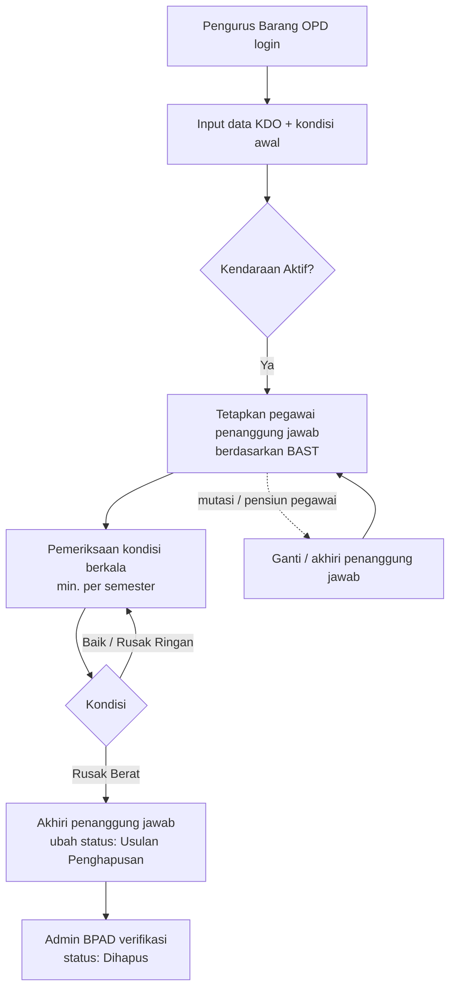
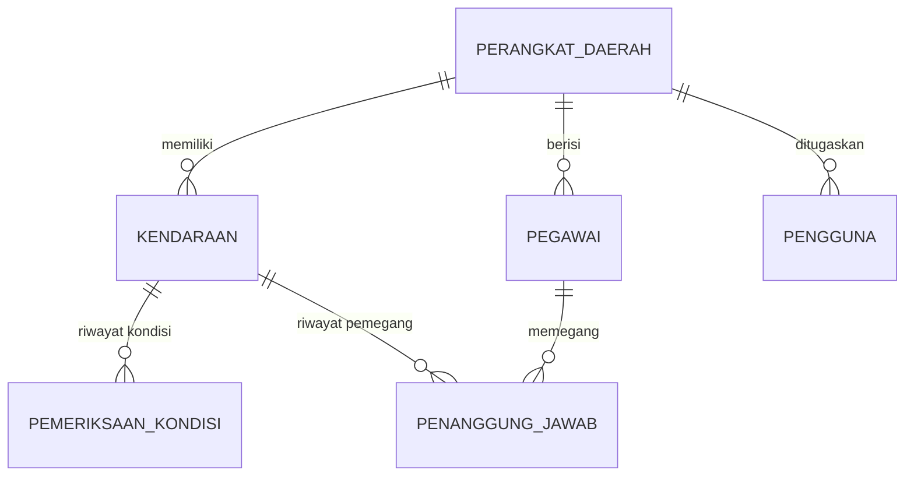

# Dokumen Kebutuhan — SI-KDO (Kendaraan Dinas Operasional)

| Item | Keterangan |
|------|------------|
| Versi | 1.0 (MVP) |
| Status | Draf untuk review pengguna |
| Lingkup | Pendataan KDO, kondisi, penanggung jawab, rekap & laporan |

## 1. Latar Belakang & Tujuan

KDO merupakan aset BMD bernilai tinggi yang tersebar di banyak Perangkat Daerah. Pendataan yang masih manual
(spreadsheet per OPD) menyulitkan BPAD untuk mengetahui **jumlah, kondisi, dan siapa pemegang** setiap kendaraan.

Tujuan aplikasi:

1. Satu sumber data KDO untuk seluruh Perangkat Daerah.
2. Kondisi kendaraan selalu mutakhir dan memiliki **jejak riwayat pemeriksaan**.
3. Setiap kendaraan aktif memiliki **pegawai penanggung jawab** yang tercatat dengan dasar BAST.
4. Rekapitulasi siap pakai untuk monitoring dan pelaporan BMD.

## 2. Pengguna & Hak Akses

| Peran | Pengguna | Hak akses |
|-------|----------|-----------|
| Administrator | BPAD (Pengelola Barang) | Seluruh data semua Perangkat Daerah; kelola master Perangkat Daerah; menetapkan status "Dihapus"; memindahkan KDO antar-OPD; melihat log aktivitas |
| Pengurus Barang OPD | Pengurus Barang Pengguna | Hanya data milik Perangkat Daerahnya: tambah/ubah KDO, catat pemeriksaan, tetapkan/akhiri penanggung jawab, kelola pegawai, ekspor laporan |

## 3. Ruang Lingkup Fungsional

| Kode | Fitur | Deskripsi |
|------|-------|-----------|
| F-01 | Login / logout | Autentikasi username + kata sandi, sesi berlaku 8 jam |
| F-02 | Dashboard | Total KDO, jumlah per kondisi, KDO tanpa penanggung jawab, belum diperiksa > 6 bulan, komposisi kondisi per OPD, STNK habis/≤ 30 hari |
| F-03 | Daftar KDO | Pencarian (no. polisi, merk, tipe, nama penanggung jawab) dan filter OPD, jenis, kondisi, status, tanpa penanggung jawab |
| F-04 | Tambah / ubah KDO | Identitas barang (kode barang, no. register, nilai & tahun perolehan) dan kendaraan (no. polisi, rangka, mesin, BPKB, STNK, dll.) |
| F-05 | Pemeriksaan kondisi | Catat tanggal, kondisi, odometer, catatan; memperbarui kondisi terkini |
| F-06 | Penanggung jawab | Tetapkan / ganti / akhiri penugasan pegawai dengan nomor BAST |
| F-07 | Master pegawai | NIP, nama, jabatan, OPD, status aktif |
| F-08 | Master Perangkat Daerah | Kode dan nama OPD (Admin) |
| F-09 | Laporan | Ekspor CSV daftar KDO sesuai filter (dapat dibuka di Excel) |
| F-10 | Log aktivitas | Jejak audit seluruh perubahan data (Admin) |

## 4. Proses Bisnis (TO-BE)

## 5. Business Rules

| Kode | Aturan |
|------|--------|
| BR-01 | Nomor polisi, nomor rangka, dan nomor mesin unik di seluruh aplikasi. |
| BR-02 | Kombinasi kode barang + nomor register unik per Perangkat Daerah. |
| BR-03 | Format nomor polisi: `[1–2 huruf] [1–4 angka] [0–3 huruf]`, disimpan huruf kapital (contoh `B 1234 PQR`). |
| BR-04 | Pengurus Barang OPD hanya dapat melihat dan mengubah data milik OPD-nya; OPD pada data baru otomatis diisi OPD pengguna. |
| BR-05 | Kondisi kendaraan **hanya** berubah melalui pemeriksaan kondisi, sehingga setiap perubahan memiliki riwayat. Saat KDO ditambahkan, kondisi awal dicatat sebagai pemeriksaan pertama. |
| BR-06 | Tanggal pemeriksaan tidak boleh melebihi hari ini; kilometer tidak boleh lebih kecil dari pemeriksaan sebelumnya; catatan wajib untuk kondisi Rusak Ringan/Rusak Berat. |
| BR-07 | Satu kendaraan hanya memiliki **satu** penanggung jawab aktif. Penetapan penanggung jawab baru otomatis mengakhiri penugasan sebelumnya pada tanggal mulai yang baru. |
| BR-08 | Penanggung jawab harus pegawai **aktif** dari Perangkat Daerah pemilik kendaraan; nomor BAST wajib. |
| BR-09 | Penanggung jawab hanya dapat ditetapkan untuk kendaraan berstatus Aktif. Status tidak dapat diubah ke "Usulan Penghapusan"/"Dihapus" selama masih ada penanggung jawab aktif. |
| BR-10 | Hanya Admin BPAD yang dapat menetapkan status "Dihapus" dan memindahkan KDO antar-Perangkat Daerah. |
| BR-11 | Pegawai yang masih memegang KDO tidak dapat dinonaktifkan atau dipindah OPD sebelum penugasannya diakhiri. |
| BR-12 | NIP terdiri dari 18 digit angka dan unik. |
| BR-13 | Data tidak dihapus fisik; penghapusan BMD direpresentasikan dengan status, dan setiap perubahan tercatat di log aktivitas. |

## 6. Model Data (ringkas)

## 7. Skenario Uji (UAT)

| No | Skenario | Hasil yang diharapkan | Otomatis* |
|----|----------|-----------------------|-----------|
| 1 | Login dengan kata sandi salah | Ditolak, pesan "Username atau kata sandi salah" | ✔ |
| 2 | Pengurus Barang Dishub membuka KDO Dinkes | Ditolak (403) / tidak tampil di daftar | ✔ |
| 3 | Tambah KDO dengan no. polisi yang sudah ada | Ditolak, "Nomor polisi sudah terdaftar" | ✔ |
| 4 | Tambah KDO dengan no. polisi `1234` | Ditolak, format tidak valid | ✔ |
| 5 | Tetapkan pegawai OPD lain sebagai penanggung jawab | Ditolak | ✔ |
| 6 | Ganti penanggung jawab | PJ lama otomatis berakhir di tanggal mulai PJ baru; riwayat 2 baris | ✔ |
| 7 | Ubah status ke Usulan Penghapusan saat masih ada PJ | Ditolak | ✔ |
| 8 | Catat pemeriksaan Rusak Ringan tanpa catatan | Ditolak | ✔ |
| 9 | Catat pemeriksaan dengan kilometer mundur | Ditolak | ✔ |
| 10 | Catat pemeriksaan valid | Kondisi kendaraan berubah, riwayat bertambah | ✔ |
| 11 | Pengurus Barang OPD set status Dihapus | Ditolak (403) | ✔ |
| 12 | Ekspor CSV | File terunduh dengan header kolom laporan | ✔ |

\* ✔ = tercakup oleh `npm test` (test/api.test.js). Alur UI end-to-end diverifikasi manual/Playwright.

## 8. Asumsi & Hal untuk Dikonfirmasi

1. **Integrasi** dengan aplikasi BMD/SIPKD/e-Aset eksisting (sinkronisasi kode barang & register) — belum termasuk MVP; data diinput manual.
2. **Batasan jumlah KDO per jabatan** (mis. ketentuan KDO jabatan per eselon) — belum divalidasi; aplikasi menampilkan jumlah KDO yang dipegang pegawai sebagai informasi.
3. **Upload dokumen** (scan BAST, STNK, BPKB, foto kendaraan) — kandidat fase 2.
4. **Integrasi data pegawai** dengan sistem kepegawaian (SIMPEG) — saat ini master pegawai dikelola manual.
5. **Alur persetujuan penghapusan** BMD yang lebih rinci (verifikasi, SK penghapusan) — saat ini cukup perubahan status oleh Admin.
6. Periode pemeriksaan kondisi diasumsikan minimal **per semester** (indikator "belum diperiksa > 6 bulan").
