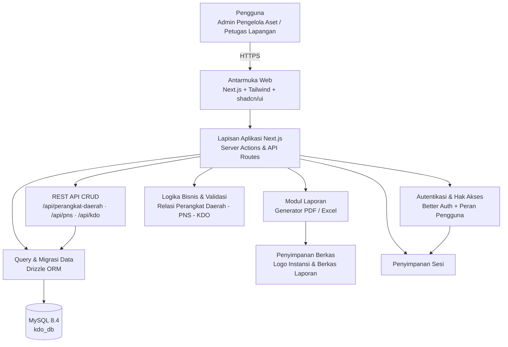
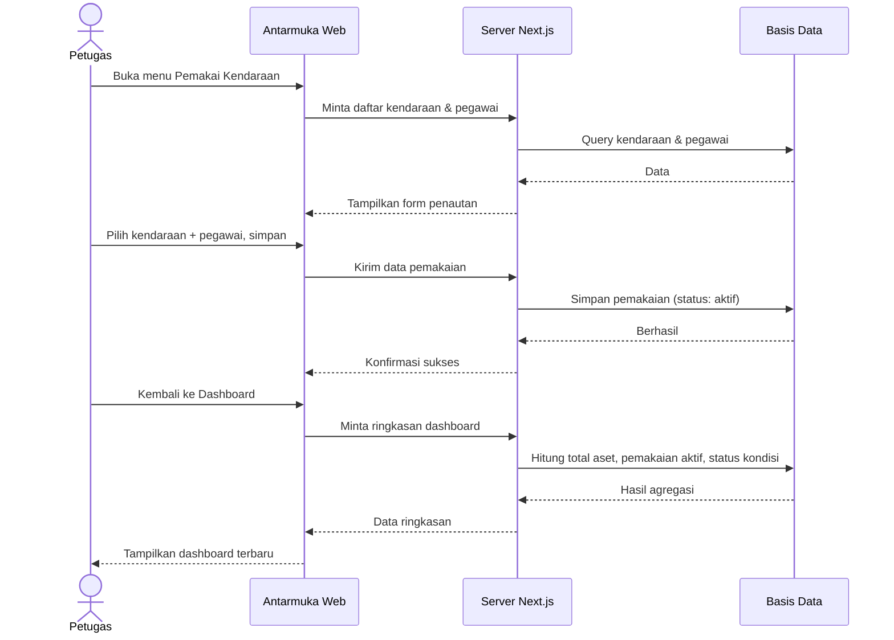
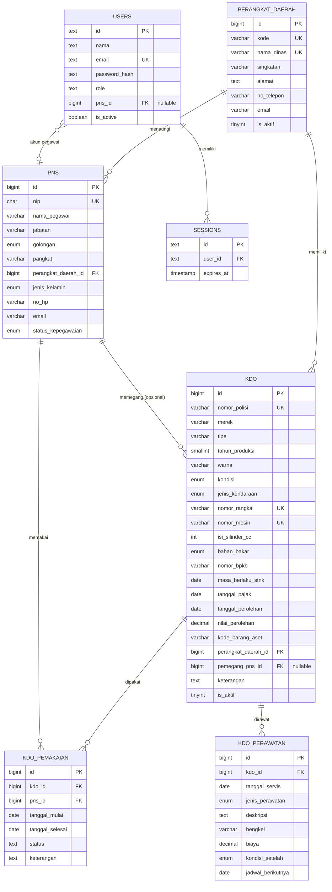

# PRD — Project Requirements Document

## 1. Overview

### Masalah yang Diselesaikan
Perangkat Daerah memiliki banyak Kendaraan Dinas Operasional (KDO) sebagai bagian dari Barang Milik Daerah (BMD). Saat ini pendataan kendaraan, kondisi, dan siapa yang memakainya sering dilakukan secara manual atau tersebar di banyak berkas, sehingga:

- Sulit mengetahui jumlah dan kondisi kendaraan dinas secara cepat.
- Tidak jelas siapa pegawai yang bertanggung jawab atas suatu kendaraan.
- Riwayat perawatan dan biaya servis tidak terdokumentasi rapi.
- Pembuatan laporan rekapitulasi memakan waktu karena harus disusun ulang setiap kali dibutuhkan.

### Tujuan Utama Aplikasi
Menyediakan **satu tempat** untuk mengelola seluruh data kendaraan dinas operasional milik Instansi Aset Daerah Jakarta, dengan tujuan:

1. Mengetahui **total aset kendaraan** dan **kondisinya** dalam satu layar (dashboard).
2. Mencatat **pegawai penanggung jawab** atas setiap kendaraan beserta riwayat pemakaiannya.
3. Mendokumentasikan **riwayat perawatan** dan biaya servis, termasuk jadwal servis berikutnya.
4. Menghasilkan **laporan siap pakai** yang dapat dicetak atau diunduh (PDF/Excel) tanpa menyusun ulang data.
5. Membatasi akses data melalui **akun dan peran pengguna** agar data aset tetap aman.
6. Menyerahkan pekerjaan bersama **bukti dokumentasi dan pengujian**: screenshot frontend (gaya Crossdock) di dalam workbook Excel, koleksi Postman untuk backend, serta README, `AGENTS.md`, dan manual setup yang terstruktur.

### Nilai Utama bagi Pengguna
- **Semua di satu tempat** — data kendaraan, pemakai, perawatan, dan laporan saling terhubung.
- **Laporan siap pakai** — rekap kendaraan, pemakaian, dan perawatan bisa langsung dicetak.
- **Kemenangan pertama (first win)** — saat pertama membuka aplikasi, petugas langsung melihat daftar aset, dashboard kendaraan yang sedang aktif digunakan, dan total aset.

---

## 2. Requirements

### Persyaratan Fungsional
| No | Persyaratan | Keterangan |
|----|-------------|------------|
| F1 | Pengguna dapat melihat dashboard ringkasan kendaraan | Total aset, kendaraan sedang dipakai, status kondisi, aset terbaru |
| F2 | Pengguna dapat menambah, melihat, mengubah, dan menghapus data kendaraan dinas | Termasuk pencarian dan penyaringan |
| F3 | Pengguna dapat mencatat data pegawai dan menautkannya ke kendaraan | Beserta riwayat pemakaian |
| F4 | Pengguna dapat mencatat riwayat perawatan kendaraan | Tanggal, biaya, kondisi setelah servis, jadwal berikutnya |
| F5 | Pengguna dapat membuat, mencetak, dan mengunduh laporan | Format PDF dan Excel |
| F6 | Pengguna dapat masuk dengan akun dan memiliki peran berbeda | Pengelola aset vs petugas lapangan |
| F7 | Pengguna dapat mengatur data instansi dan pengingat | Nama instansi dan logo untuk kop laporan |
| F8 | **CRUD penuh atas tiga entitas master** sebagai fitur utama aplikasi | `perangkat_daerah`, `pns`, dan `kdo`: tambah, lihat (list + detail), ubah, hapus, pencarian & penyaringan, validasi field unik |
| F9 | Dokumentasi frontend berupa screenshot setiap halaman, form, dan dialog | Disusun gaya Crossdock: satu lembar per alur, gambar ditempel di dalam workbook Excel beserta judul, langkah, dan URL halaman |
| F10 | Backend terdokumentasi sebagai REST API dan dapat diuji dengan Postman | Koleksi Postman berisi seluruh endpoint CRUD + contoh request/response, siap dieksekusi berurutan |
| F11 | README, `AGENTS.md`, dan manual setup terstruktur | README: gambaran aplikasi, relasi entitas, cara menjalankan, daftar endpoint. `AGENTS.md`: konvensi kode & aturan kerja agent. Manual setup: langkah instalasi dari nol (Laragon, `kdo_db`, migrasi, seed) beserta troubleshooting |

### Persyaratan Non-Fungsional
- **Mudah dipakai** — antarmuka sederhana, dapat digunakan staf non-teknis tanpa pelatihan panjang.
- **Cepat** — pencarian dan penyaringan data kendaraan merespons dalam hitungan detik.
- **Aman** — data hanya dapat diakses setelah login; hak ubah dibatasi sesuai peran.
- **Konsisten** — data kendaraan, pemakaian, dan perawatan saling terhubung (tidak ada input ganda).
- **Dapat dicetak** — tata letak laporan rapi, memuat kop instansi, dan siap ditandatangani.
- **Ringan** — dapat berjalan pada server instansi maupun layanan cloud berskala kecil.
- **Kualitas kode tinggi** — struktur folder konsisten, penamaan jelas, validasi input di satu tempat, penanganan error seragam (kode status + pesan), tidak ada duplikasi logika, dan setiap endpoint/perilaku penting punya bukti uji (Postman untuk backend, screenshot untuk frontend).
- **Integritas relasi** — foreign key `perangkat_daerah → pns → kdo` dijaga di level basis data dan divalidasi di level API (tidak boleh menghapus perangkat daerah yang masih punya `pns`/`kdo`, tidak boleh menunjuk `pns` nonaktif sebagai pemegang).
- **Terstruktur untuk diserahkan** — dokumentasi (README, `AGENTS.md`, manual setup, Excel screenshot, Postman) diperbarui bersamaan dengan kode, bukan setelah proyek selesai.

### Batasan & Asumsi
- Aplikasi digunakan internal oleh instansi, bukan publik.
- Jumlah kendaraan dalam skala ratusan hingga beberapa ribu unit.
- Data awal kendaraan dapat dimasukkan manual atau melalui impor bertahap.
- Di luar cakupan: pelacakan GPS real-time, aplikasi mobile native, integrasi langsung dengan sistem akuntansi daerah (dapat menjadi pengembangan lanjutan).

---

## 3. Core Features

Fitur disusun mengikuti kerangka roadmap yang telah disetujui, dikelompokkan per fase.

### Fase 0 — CRUD Master Data `[high]` ★ fitur utama
Tiga entitas master dikelola penuh (Create, Read, Update, Delete) lebih dulu, karena seluruh fitur lain bergantung pada data ini.

- **CRUD Perangkat Daerah** — tambah/ubah/hapus/daftar `perangkat_daerah` beserta pencarian dan filter `is_aktif`.
- **CRUD PNS** — tambah/ubah/hapus/daftar `pns`, pemilihan `perangkat_daerah_id`, filter `status_kepegawaian`, validasi `nip` unik 18 digit.
- **CRUD KDO** — tambah/ubah/hapus/daftar `kdo`, pemilihan `perangkat_daerah_id` dan `pemegang_pns_id`, validasi `nomor_polisi`/`nomor_rangka`/`nomor_mesin` unik serta rentang `tahun_produksi`.
- **Relasi Terjaga** — menampilkan relasi antar entitas di UI (mis. daftar PNS per perangkat daerah, kendaraan yang dipegang seorang PNS) dan menolak hapus data yang masih direferensikan.
- **Bukti Dokumentasi (Postman, Excel, README)** — Workbook Excel gaya Crossdock untuk screenshot frontend, koleksi Postman untuk backend, serta README, AGENTS.md, dan docs/SETUP.md yang terstruktur.

### Fase 1 — Dashboard Kendaraan `[high]`
- **Ringkasan Total Aset** — Menampilkan jumlah seluruh kendaraan dinas yang tercatat.
- **Kendaraan Sedang Dipakai** — Menampilkan daftar kendaraan yang sedang digunakan beserta nama pemakainya.
- **Status Kondisi Sekilas** — Menunjukkan berapa kendaraan dalam kondisi baik, perlu servis, atau rusak.
- **Aset Terbaru** — Menampilkan kendaraan yang baru ditambahkan agar mudah dipantau.

### Fase 2 — Daftar Kendaraan Dinas `[high]`
- **Cari & Saring** — Menemukan kendaraan dengan cepat berdasarkan nomor polisi, jenis, atau statusnya.
- **Detail Kendaraan** — Melihat informasi lengkap satu kendaraan termasuk kondisi terkininya.
- **Tambah Kendaraan Baru** — Memasukkan data kendaraan dinas yang belum tercatat ke dalam aplikasi.
- **Ubah & Hapus Data** — Memperbaiki atau menghapus data kendaraan yang keliru.

### Fase 2 — Pemakai Kendaraan `[medium]`
- **Daftar Pegawai** — Menyimpan data pegawai yang bisa ditunjuk sebagai pemakai kendaraan.
- **Tautkan Pemakai** — Menghubungkan satu kendaraan dengan pegawai yang memakainya.
- **Riwayat Pemakaian** — Melihat catatan siapa memakai kendaraan apa dan dalam periode kapan.

### Fase 3 — Riwayat Perawatan `[high]`
- **Catat Perawatan** — Menyimpan catatan servis beserta tanggal dan biayanya.
- **Jadwal Servis Berikutnya** — Memberi pengingat kapan kendaraan harus diservis lagi.
- **Rekap Biaya Perawatan** — Menampilkan total biaya perawatan tiap kendaraan.
- **Kondisi Setelah Servis** — Memperbarui status kondisi kendaraan setelah menjalani perawatan.

### Fase 3 — Laporan & Cetak `[high]`
- **Laporan Daftar Kendaraan** — Menyusun rekapitulasi seluruh kendaraan dalam format siap cetak.
- **Laporan Pemakaian** — Menyusun rekap pemakaian kendaraan dalam periode tertentu.
- **Laporan Perawatan** — Menyusun rekap biaya dan riwayat servis kendaraan.
- **Cetak & Unduh** — Mencetak atau menyimpan laporan sebagai berkas PDF/Excel.

### Fase 4 — Masuk & Hak Akses `[medium]`
- **Masuk Akun** — Petugas masuk ke aplikasi menggunakan akun instansinya.
- **Kelola Pengguna** — Mengatur daftar orang yang boleh memakai aplikasi.
- **Peran & Izin** — Membedakan hak pengelola aset dan petugas lapangan.

### Fase 4 — Pengaturan Aplikasi `[low]`
- **Data Instansi** — Mengatur nama instansi dan logo yang tampil pada kop laporan.
- **Pilihan Terkendali (ENUM)** — jenis kendaraan, kondisi, golongan, bahan bakar, dan status kepegawaian memakai ENUM di basis data sehingga tidak perlu tabel kategori terpisah.
- **Pengingat** — Mengatur pengingat servis dan pembaruan data kendaraan.

## 4. User Flow

### A. Alur Pertama Kali (menuju "first win")
1. Petugas membuka aplikasi dan **masuk dengan akun instansi** (Fase 4 — agar dashboard tetap aman).
2. Sistem menampilkan **Dashboard Kendaraan**: total aset, kendaraan sedang dipakai, status kondisi, dan aset terbaru.
3. Petugas langsung mendapat gambaran kondisi kendaraan dinas dalam satu layar.

### B. Alur Pendataan Kendaraan
1. Petugas membuka menu **Daftar Kendaraan Dinas**.
2. Petugas menekan **Tambah Kendaraan Baru** dan mengisi nomor polisi, merk, jenis, tahun, dan kondisi.
3. Data tersimpan dan muncul di daftar serta pada bagian **Aset Terbaru** di dashboard.
4. Petugas dapat **mencari/menyaring**, membuka **detail**, atau **mengubah/menghapus** data bila ada kekeliruan.

### C. Alur Penautan Pemakai
1. Petugas membuka menu **Pemakai Kendaraan** dan menambah **data pegawai**.
2. Petugas memilih kendaraan dan **menautkan pegawai** yang bertanggung jawab.
3. Dashboard otomatis menampilkan kendaraan tersebut sebagai **Kendaraan Sedang Dipakai**.
4. Saat pemakaian selesai, petugas menutup penugasan sehingga terbentuk **riwayat pemakaian**.

### D. Alur Perawatan
1. Petugas membuka **Riwayat Perawatan** pada kendaraan terkait.
2. Petugas menekan **Catat Perawatan**, mengisi tanggal servis, jenis perawatan, biaya, dan bengkel.
3. Petugas mengisi **Kondisi Setelah Servis** dan **Jadwal Servis Berikutnya**.
4. Sistem memperbarui status kondisi kendaraan serta menampilkan **rekap biaya perawatan**.

### E. Alur Laporan
1. Petugas membuka menu **Laporan & Cetak**.
2. Petugas memilih jenis laporan: **Daftar Kendaraan**, **Pemakaian**, atau **Perawatan**, serta periode bila diperlukan.
3. Sistem menampilkan pratinjau laporan dengan kop instansi.
4. Petugas menekan **Cetak** atau mengunduh sebagai **PDF/Excel**.

### F. Alur Pengaturan (Admin)
1. Admin membuka **Pengaturan Aplikasi**.
2. Admin mengatur **Data Instansi** (nama & logo), memeriksa **Pilihan ENUM** yang tersedia (jenis kendaraan, status kondisi, bahan bakar), dan **Pengingat** servis.
3. Admin mengelola **pengguna** dan **peran/izin** melalui menu Masuk & Hak Akses.

---

## 5. Architecture

Aplikasi dibangun sebagai **aplikasi web terpusat** dengan tiga lapisan utama: antarmuka pengguna (browser), lapisan aplikasi (server Next.js yang menangani REST API, autentikasi, logika bisnis, dan pembuatan laporan), serta basis data relasional MySQL untuk menyimpan data perangkat daerah, pegawai, dan kendaraan.

Fitur utama adalah **CRUD atas tiga entitas master** (`perangkat_daerah`, `pns`, `kdo`) yang diekspos sebagai **REST API** dan dikonsumsi antarmuka web. Backend diuji lewat **Postman** (koleksi tersimpan di repo), frontend didokumentasikan lewat **screenshot di workbook Excel**.



### Alur Data Utama (Contoh: Menautkan Pemakai lalu Tampil di Dashboard)



### Catatan Arsitektur
- **CRUD sebagai inti** — tiga entitas master punya endpoint REST lengkap (`GET` list, `GET` detail, `POST`, `PUT/PATCH`, `DELETE`) dengan format respons seragam: `{ data, meta }` untuk sukses dan `{ error: { code, message, details } }` untuk gagal.
- **Validasi berlapis** — skema validasi (mis. Zod) dipakai bersama oleh API dan form sehingga pesan error konsisten; constraint unik/FK tetap ditegakkan di MySQL.
- **Autentikasi** ditangani Better Auth; setiap permintaan data diperiksa peran pengguna sebelum diolah.
- **Logika bisnis** ditempatkan di server agar aturan relasi (mis. satu kendaraan hanya punya satu pemakaian aktif, perangkat daerah tidak boleh dihapus bila masih dipakai) konsisten.
- **Laporan** dibuat di server untuk menjaga hasil cetak identik antar perangkat.
- **Basis data relasional** dipilih karena data bersifat terstruktur dan saling berhubungan (perangkat daerah–pns–kdo).

### Dokumentasi & Bukti Uji (bagian dari arsitektur, bukan lampiran)

| Artefak | Isi | Lokasi yang disarankan |
|---|---|---|
| `docs/screenshots/*.xlsx` | Workbook Excel gaya Crossdock: per lembar berisi alur + gambar screenshot (`Insert > Picture > Place in Cell`), kolom nomor langkah, aksi, hasil yang diharapkan | `docs/screenshots/` |
| `docs/postman/KDO.postman_collection.json` | Seluruh endpoint CRUD + variabel `baseUrl`, contoh body, dan skrip uji status code | `docs/postman/` |
| `docs/postman/KDO.postman_environment.json` | Environment `local` (`http://localhost:3000`, token, ID hasil create) | `docs/postman/` |
| `README.md` | Ringkasan aplikasi, diagram relasi tiga entitas, cara menjalankan cepat, tabel endpoint, tautan ke dokumentasi lain | root repo |
| `AGENTS.md` | Aturan kerja agent: konvensi penamaan, struktur folder, larangan mengubah migrasi yang sudah dirilis, standar error/response, cara memperbarui dokumentasi setiap menambah endpoint | root repo |
| `docs/SETUP.md` | Manual setup terstruktur: prasyarat → buat database di Laragon → `.env` → migrasi → seed data awal (PD-001…PD-003) → jalankan dev server → verifikasi via Postman | `docs/` |

Urutan kerja dokumentasi: endpoint dibuat → dicoba di Postman → koleksi diperbarui → screenshot UI diambil → workbook Excel diperbarui → README/`AGENTS.md`/`SETUP.md` disesuaikan.

---

## 6. Database Schema

Basis data: **MySQL 8.4** (database `kdo_db`, dijalankan lokal dengan Laragon). Inti skema adalah **tiga tabel master**: `perangkat_daerah`, `pns`, dan `kdo`. DDL lengkap tersedia di `kdo_master_tables.sql`.

### Relasi Tabel Master

```
perangkat_daerah 1 ──< pns
perangkat_daerah 1 ──< kdo
pns              1 ──< kdo   (pemegang / penanggung jawab, opsional)
```

### 6.1 `perangkat_daerah` — master perangkat daerah (pemilik aset)
| Field | Tipe | Kegunaan |
|-------|------|----------|
| id | BIGINT UNSIGNED, PK, auto increment | Identitas unik |
| kode | VARCHAR(20), unik | Kode perangkat daerah, mis. `PD-001` |
| nama_dinas | VARCHAR(150), unik | Dinas Pendidikan, Dinas Kesehatan, Dinas PUPR |
| singkatan | VARCHAR(30) | Mis. `DISDIK`, `DINKES`, `PUPR` |
| alamat | TEXT | Alamat kantor |
| no_telepon | VARCHAR(20) | Kontak kantor |
| email | VARCHAR(100) | Email kantor |
| is_aktif | TINYINT(1), default 1 | Status aktif |
| created_at, updated_at | TIMESTAMP | Jejak waktu |

**Data awal:**

| kode | nama_dinas | singkatan |
|------|------------|-----------|
| PD-001 | Dinas Pendidikan | DISDIK |
| PD-002 | Dinas Kesehatan | DINKES |
| PD-003 | Dinas PUPR | PUPR |

### 6.2 `pns` — master pegawai (calon pemegang kendaraan)
| Field | Tipe | Kegunaan |
|-------|------|----------|
| id | BIGINT UNSIGNED, PK, auto increment | Identitas unik |
| nip | CHAR(18), unik | Nomor induk pegawai |
| nama_pegawai | VARCHAR(150) | Nama pegawai |
| jabatan | VARCHAR(150) | Jabatan |
| golongan | ENUM `I/a` … `IV/e` | Golongan kepegawaian |
| pangkat | VARCHAR(50) | Mis. Penata Muda |
| perangkat_daerah_id | BIGINT UNSIGNED, FK → `perangkat_daerah.id` | Unit kerja pegawai |
| jenis_kelamin | ENUM('L','P') | Jenis kelamin |
| no_hp | VARCHAR(20) | Kontak pegawai |
| email | VARCHAR(100) | Email pegawai |
| status_kepegawaian | ENUM('aktif','pensiun','mutasi','nonaktif'), default `aktif` | Status pegawai |
| created_at, updated_at | TIMESTAMP | Jejak waktu |

### 6.3 `kdo` — master kendaraan dinas operasional
| Field | Tipe | Kegunaan |
|-------|------|----------|
| id | BIGINT UNSIGNED, PK, auto increment | Identitas unik |
| nomor_polisi | VARCHAR(15), unik | Mis. `B 1234 ABC` |
| merek | VARCHAR(50) | Merek kendaraan |
| tipe | VARCHAR(80) | Tipe/model kendaraan |
| tahun_produksi | SMALLINT UNSIGNED | 1980–2100 |
| warna | VARCHAR(30) | Warna kendaraan |
| kondisi | ENUM('baik','rusak_ringan','rusak_berat'), default `baik` | Kondisi terkini |
| jenis_kendaraan | ENUM('roda_2','roda_4','roda_6','bus','truk','lainnya') | Jenis kendaraan |
| nomor_rangka | VARCHAR(30), unik | Nomor rangka |
| nomor_mesin | VARCHAR(30), unik | Nomor mesin |
| isi_silinder_cc | INT UNSIGNED | Kapasitas mesin |
| bahan_bakar | ENUM('bensin','solar','listrik','hybrid','lainnya') | Bahan bakar |
| nomor_bpkb | VARCHAR(30) | Nomor BPKB |
| masa_berlaku_stnk | DATE | Masa berlaku STNK |
| tanggal_pajak | DATE | Jatuh tempo pajak |
| tanggal_perolehan | DATE | Tanggal perolehan aset |
| nilai_perolehan | DECIMAL(15,2) | Nilai perolehan (Rp) |
| kode_barang_aset | VARCHAR(30) | Kode register BMD |
| perangkat_daerah_id | BIGINT UNSIGNED, FK → `perangkat_daerah.id` | Pemilik kendaraan |
| pemegang_pns_id | BIGINT UNSIGNED, FK → `pns.id`, boleh kosong | Pegawai penanggung jawab |
| keterangan | TEXT | Catatan tambahan |
| is_aktif | TINYINT(1), default 1 | Status data aktif |
| created_at, updated_at | TIMESTAMP | Jejak waktu |

### 6.4 Tabel Pendukung

Tabel berikut tidak menggantikan tiga tabel master di atas; fungsinya menampung akun, data turunan, dan pengaturan aplikasi.

**`users`** — akun pengguna aplikasi
| Field | Tipe | Kegunaan |
|-------|------|----------|
| id | text (PK) | Identitas unik pengguna |
| nama | text | Nama pengguna |
| email | text (unik) | Login pengguna |
| password_hash | text | Kata sandi terenkripsi |
| role | text | Peran: `admin` atau `petugas` |
| pns_id | BIGINT UNSIGNED (FK, opsional) | Kaitan akun ke data pegawai |
| is_active | boolean | Status akun aktif/nonaktif |
| created_at | timestamp | Waktu akun dibuat |

**`sessions`** — sesi login (dikelola Better Auth)
| Field | Tipe | Kegunaan |
|-------|------|----------|
| id | text (PK) | Identitas sesi |
| user_id | text (FK) | Pemilik sesi |
| expires_at | timestamp | Waktu sesi berakhir |
| created_at | timestamp | Waktu sesi dibuat |

**`kdo_pemakaian`** — riwayat pemakaian/penugasan kendaraan (pelengkap `kdo.pemegang_pns_id`)
| Field | Tipe | Kegunaan |
|-------|------|----------|
| id | BIGINT UNSIGNED, PK | Identitas catatan pemakaian |
| kdo_id | BIGINT UNSIGNED, FK → `kdo.id` | Kendaraan yang dipakai |
| pns_id | BIGINT UNSIGNED, FK → `pns.id` | Pegawai pemakai |
| tanggal_mulai | date | Awal pemakaian |
| tanggal_selesai | date | Akhir pemakaian (kosong = masih aktif) |
| status | text | `aktif` atau `selesai` |
| keterangan | text | Keperluan pemakaian |
| created_at | timestamp | Waktu pencatatan |

**`kdo_perawatan`** — riwayat perawatan kendaraan (anak dari `kdo`)
| Field | Tipe | Kegunaan |
|-------|------|----------|
| id | BIGINT UNSIGNED, PK | Identitas catatan perawatan |
| kdo_id | BIGINT UNSIGNED, FK → `kdo.id` (ON DELETE CASCADE) | Kendaraan yang dirawat |
| tanggal_servis | date | Tanggal pelaksanaan servis |
| jenis_perawatan | ENUM('rutin','perbaikan','ganti_oli','pajak','lainnya') | Jenis servis |
| deskripsi | text | Uraian pekerjaan |
| bengkel | varchar(150) | Nama bengkel/penyedia jasa |
| biaya | DECIMAL(15,2) | Biaya perawatan (Rp) |
| kondisi_setelah | ENUM('baik','rusak_ringan','rusak_berat') | Kondisi kendaraan setelah servis |
| jadwal_berikutnya | date | Jadwal servis berikutnya (pengingat) |
| created_at, updated_at | timestamp | Jejak waktu |

**Catatan:** tidak ada tabel `categories`. Pilihan jenis kendaraan, kondisi, bahan bakar, golongan, dan status kepegawaian sudah berupa **ENUM** pada tiga tabel master, sehingga penambahan pilihan berarti migrasi ENUM — bukan baris data baru.

**`settings`** — pengaturan instansi & pengingat
| Field | Tipe | Kegunaan |
|-------|------|----------|
| id | text (PK) | Identitas pengaturan |
| nama_instansi | text | Nama instansi untuk kop laporan |
| logo_url | text | Lokasi berkas logo instansi |
| alamat | text | Alamat instansi |
| pengingat_servis_hari | integer | Jumlah hari sebelum pengingat servis muncul |
| updated_at | timestamp | Waktu perubahan terakhir |

### Diagram Relasi (ER)



**Aturan relasi yang wajib dijaga API:**
- `pns.perangkat_daerah_id` **wajib** → hapus `perangkat_daerah` ditolak bila masih ada `pns` (kode `409 CONFLICT`).
- `kdo.perangkat_daerah_id` **wajib** → hapus ditolak bila masih ada `kdo` miliknya.
- `kdo.pemegang_pns_id` **opsional** → FK memakai **`ON DELETE SET NULL`** (keputusan final): hapus `pns` tetap diizinkan, data `kdo` utuh, penanggung jawab dikosongkan. Pemegang hanya boleh `pns.status_kepegawaian = 'aktif'` (ditolak `422` bila tidak).
- `kdo_perawatan.kdo_id` dan `kdo_pemakaian.kdo_id` → `ON DELETE CASCADE`.
- Satu `kdo` hanya boleh punya **satu** `kdo_pemakaian` berstatus `aktif` (dijaga di server + unique index parsial/validasi transaksi).

---

## 7. Tech Stack

Karena tech stack belum ditentukan, direkomendasikan susunan berikut agar cepat dibangun, mudah dirawat, dan sesuai kebutuhan aplikasi internal:

| Lapisan | Teknologi | Alasan |
|---------|-----------|--------|
| **Frontend** | Next.js (App Router) + React | Satu kerangka kerja untuk tampilan dan server; navigasi cepat, cocok untuk dashboard dan tabel data |
| **Styling & UI** | Tailwind CSS + shadcn/ui | Komponen siap pakai untuk tabel, form, dialog, dan filter; tampilan konsisten dan rapi |
| **Backend** | Next.js Server Actions & API Routes | Logika bisnis dan validasi di satu tempat, tanpa perlu server terpisah |
| **Autentikasi** | Better Auth | Menangani login, sesi, dan peran pengguna (admin/petugas) dengan aman |
| **ORM** | Drizzle ORM | Skema jelas, migrasi mudah, ringan, dan mendukung tipe data yang kuat |
| **Database** | **MySQL 8.4** (database `kdo_db`, dijalankan lokal dengan Laragon) | Sesuai DDL `kdo_master_tables.sql`; mendukung FK, ENUM, dan constraint unik yang dipakai tiga tabel master. Skala ratusan–ribuan kendaraan terpenuhi tanpa beban berat |
| **Cetak Laporan** | Generator PDF (mis. React-PDF / Puppeteer) + pustaka Excel (mis. ExcelJS) | Menghasilkan laporan siap cetak dengan kop instansi dan unduhan Excel |
| **Penyimpanan Berkas** | Penyimpanan lokal server / object storage (mis. S3-compatible) | Menyimpan logo instansi dan berkas laporan |
| **Deployment** | Vercel (rekomendasi awal, gratis untuk skala kecil) atau VPS + Docker bila wajib di server instansi | Cepat diluncurkan; VPS dipilih jika data harus berada di infrastruktur daerah |
| **Monitoring & Backup** | Log aplikasi + backup basis data terjadwal harian | Menjaga keamanan data aset daerah |

### Catatan Implementasi
- **Fase 0 (CRUD tiga entitas master) dikerjakan lebih dulu** — `perangkat_daerah`, `pns`, dan `kdo` adalah fondasi; dashboard, pemakaian, perawatan, dan laporan hanya membaca data ini.
- **Tidak ada tabel kategori** — jenis kendaraan, kondisi, bahan bakar, golongan, dan status kepegawaian sudah berupa **ENUM** di tabel master; menambah pilihan berarti migrasi ENUM, bukan baris data baru.
- **Hapus PNS yang masih memegang kendaraan:** `kdo.pemegang_pns_id` memakai **`ON DELETE SET NULL`** (data kendaraan tetap aman, penanggung jawab dikosongkan). Hapus `perangkat_daerah` yang masih punya `pns`/`kdo` tetap **ditolak** dengan `409 CONFLICT`.
- Rancang **modul laporan** agar mencetak dari data yang sama dengan tampilan layar, sehingga tidak ada perbedaan angka.
- Terapkan **hak akses** sebelum aplikasi digunakan banyak orang, minimal membedakan admin pengelola aset dan petugas lapangan.